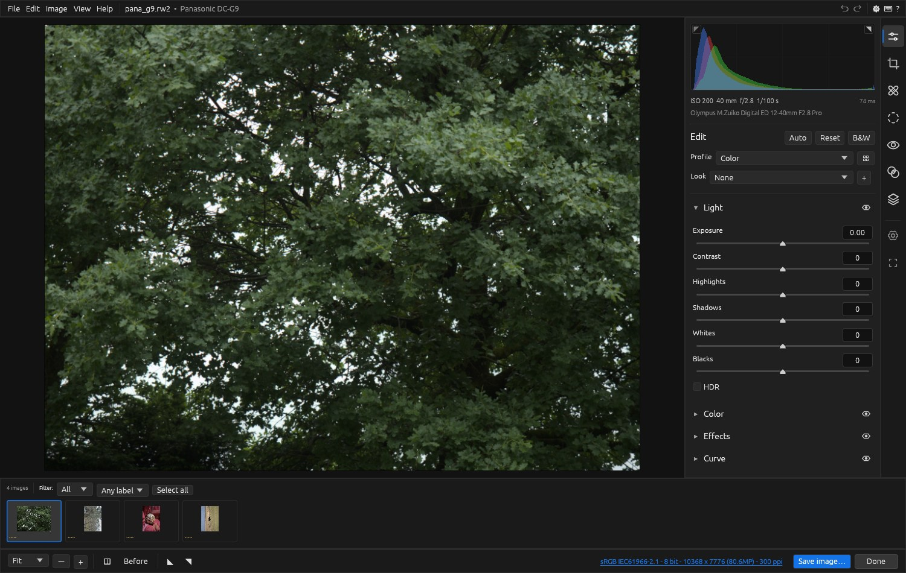
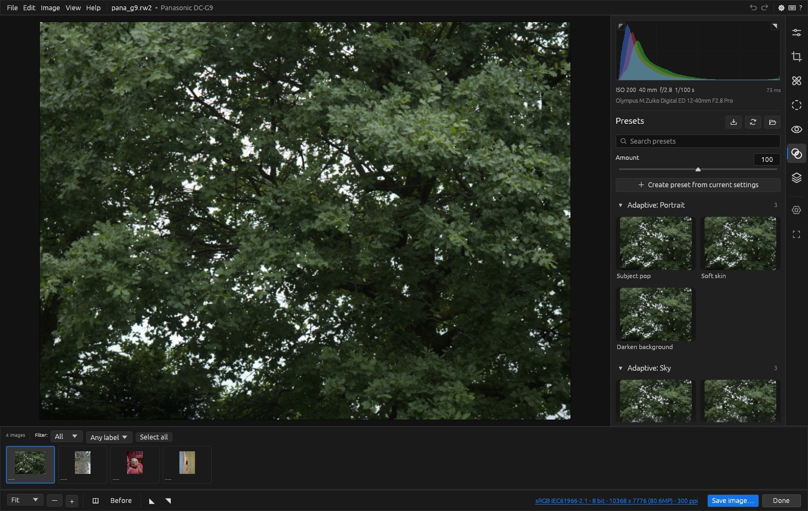
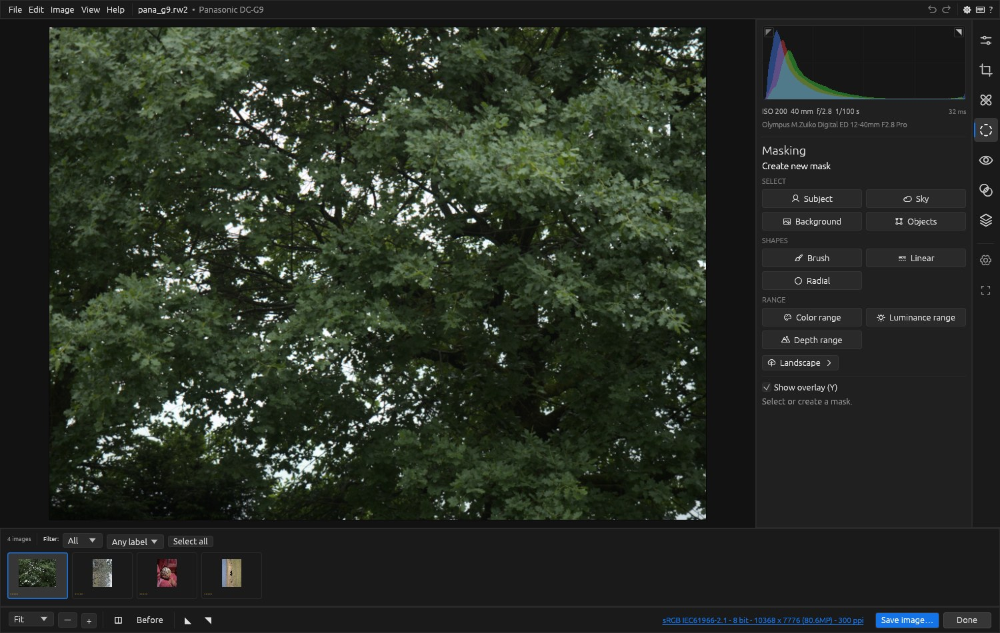
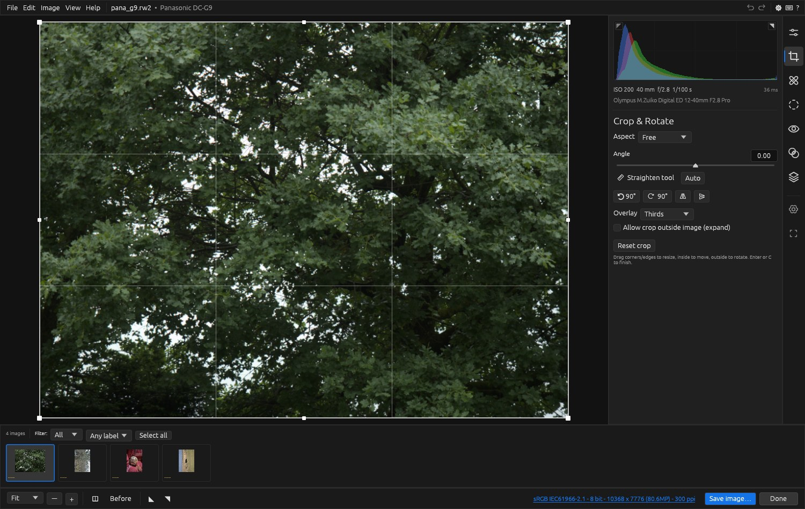

# Darkslide

**A non-destructive raw photo editor for Linux, written in Rust.**

Darkslide develops raw files from almost any camera with the panels, tools and
slider behaviour photographers know from Camera Raw-style editors. It reads
and writes XMP sidecars compatible with `crs:` settings, so edits and presets
move between tools.



> Darkslide is an independent project. It is not affiliated with, endorsed by
> or connected to Adobe. "Camera Raw" is used only to describe the workflow it
> follows.

## Features

**Develop**
- Light, Color and Effects panels: exposure, contrast, highlights, shadows,
  whites and blacks with local tone mapping; texture, clarity and dehaze;
  vibrance and saturation; white balance presets, auto, and eyedropper.
- Tone curves: parametric and point (RGB / R / G / B) with targeted adjustment.
- Color Mixer (HSL / B&W mix), Point Color, three-way Color Grading, Calibration.
- Profiles and creative looks (`.cube` LUTs, DNG camera profiles `.dcp`) with amount.
- Detail: sharpening with masking, luminance and colour noise reduction,
  Denoise, Raw Details, and 2× Super Resolution on export.
- Optics: lens profiles from lensfun (downloadable from inside the app) or Adobe LCP files,
  automatic lateral chromatic aberration removal, defringe, manual distortion.
- Geometry: Upright (auto / level / vertical / full / guided), manual transforms,
  crop and straighten with overlays.
- Effects: post-crop vignette, grain, lens blur.
- HDR editing, with HDR export to EXR, float TIFF and gain-map JPEG.

**Local adjustments and retouching**
- Masks: brush, linear and radial gradients, colour / luminance / depth ranges,
  subject / sky / background / object selections, combined with add, subtract
  and intersect.
- Remove (content-aware fill), Heal and Clone with brush or spot, dust spot
  detection, wire and people removal helpers, red-eye and pet-eye correction.

**Workflow**
- Presets panel with live previews of your photo, search and favourites; imports
  `.xmp` presets.
- Filmstrip with ratings, labels and filters, cached thumbnails that show your
  edits, sync settings across images, snapshots, unlimited undo.
- Merge to HDR and panorama (spherical, cylindrical, perspective).
- Export to JPEG, TIFF (8/16/32-bit), PNG, PSD, OpenEXR, AVIF, JPEG XL and DNG,
  with resizing, output sharpening, colour spaces and batch naming.
- A command-line mode for batch processing.

| Presets | Masking | Crop |
|---|---|---|
|  |  |  |

## Install

### Prebuilt binary

Download `darkslide-<version>-x86_64-linux.tar.gz` from the
[latest release](https://github.com/Syha-01/darkslide/releases/latest), then:

```sh
tar xzf darkslide-*-x86_64-linux.tar.gz
cd darkslide-*-x86_64-linux
./install.sh        # installs to ~/.local (binary, desktop entry, icon)
```

You need a GPU driver with Vulkan or OpenGL support. For native file dialogs
you also need the XDG desktop portal, which most desktops include.

### From source

You need Rust 1.95 or newer (via [rustup](https://rustup.rs)).

```sh
git clone https://github.com/Syha-01/darkslide
cd darkslide
cargo build --release
./target/release/darkslide [FILE|FOLDER]...
```

`scripts/install.sh` installs the build for the current user. Set
`FEATURES=ml` to include the ONNX model support described below.

## Getting started

1. Start Darkslide and drop photos or a folder onto the window. You can also
   use **Add photo(s)…**.
2. Edit with the panels on the right. Double-click a slider label to reset it.
   Hold Alt while dragging some sliders to see a clipping preview.
3. Switch tools from the strip on the far right: Edit (E), Crop (C),
   Remove (B), Masking (M), Red eye, Presets (P) and Snapshots (S).
4. Settings save automatically to an `.xmp` file next to each photo.
5. **Save image…** exports the photo. The underlined line at the bottom shows
   the current output settings.

Press `?` in the app for the full list of keyboard shortcuts.

## Command line

```sh
darkslide --cli -s 2048 -o out/ photos/*.NEF          # batch export, 2048 px long edge
darkslide --cli -f jxl -b 16 IMG.RAF                   # lossless 16-bit JPEG XL
darkslide --cli --xmp preset.xmp --set Exposure2012=+0.5 IMG.CR3
darkslide --cli --merge-hdr --deghost medium a.ARW b.ARW c.ARW
darkslide --cli --merge-pano --projection cylindrical p1.NEF p2.NEF
darkslide --cli --help
```

## Where things are stored

| What | Where |
|------|-------|
| Edit settings | `IMAGE.xmp` sidecar next to each image |
| Presets (`.xmp`) | `~/.config/darkslide/presets/` |
| Looks (`.cube`) and camera profiles (`.dcp`) | `~/.config/darkslide/profiles/` |
| Camera defaults | `~/.config/darkslide/defaults/` |
| Lens database (lensfun) | `~/.local/share/darkslide/lensfun/` (Optics panel → Download) |
| Adobe lens profiles (`.lcp`) | `~/.config/darkslide/lcp/` |
| Snapshots | `~/.local/share/darkslide/snapshots/` |
| Thumbnail cache | `~/.cache/darkslide/thumbs/` |

You can drop existing `.xmp` presets and DNG camera profiles (`.dcp`, for
example from the free DNG Converter) into these folders.

## Optional: learned masks and depth (ONNX)

Without models, subject, sky, background and object masks and Lens Blur depth
use classical detectors. For much better masks:
1. Build with `--features ml`.
2. Install ONNX Runtime 1.20 or newer (`libonnxruntime.so`). If it isn't on
   the library path, set `ORT_DYLIB_PATH` to it.
3. Put models into `~/.local/share/darkslide/models/`:

| File | Kind | Example |
|------|------|---------|
| `subject.onnx` | salient object (320 px U²-Net, or 1024 px ISNet/RMBG) | `u2netp.onnx` from rembg |
| `sky.onnx` | sky segmentation (U²-Net style output) | |
| `depth.onnx` | relative inverse depth, 518 px | Depth Anything V2 small |

```sh
cargo build --release --features ml
ORT_DYLIB_PATH=/opt/onnxruntime/lib/libonnxruntime.so ./target/release/darkslide
```

## Development

```sh
scripts/fetch-testdata.sh                 # CC0 sample raws from raw.pixls.us into testdata/
cargo test
cargo build --release -p darkslide --features screenshot
./target/release/darkslide --smoke testdata/nikon_d750.nef          # headless UI test
./target/release/darkslide --screenshot ui.png --tool crop testdata/nikon_d750.nef
```

The repository holds two crates:
- `crates/core` (`darkslide-core`): the processing engine. It covers decoding
  via [rawler](https://github.com/dnglab/dnglab), demosaicing, the scene-linear
  pipeline, masks, retouching, merges, XMP and export.
- `crates/app`: the [egui](https://github.com/emilk/egui) interface and CLI.

`PLAN.md` holds the full feature inventory and design notes.

## License

GPL-3.0-or-later. See [LICENSE](LICENSE). Icons are from
[Phosphor](https://phosphoricons.com) (MIT).
